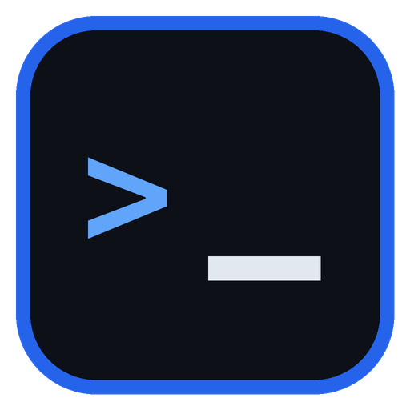

<p align="center">
  
</p>

<h1 align="center">AlphaTerm</h1>

<p align="center">
  Terminal para Windows pensada para trabajar con varios agentes de IA a la vez.<br>
  Tauri 2 · SolidJS · xterm.js 6 — versión 0.7.0
</p>

<p align="center"><a href="README.md">English</a> · <b>Español</b> · <a href="README.pt.md">Português</a></p>


## Qué tiene

- **Tres idiomas**: español, inglés y portugués, se cambian en vivo desde Configuración → Idioma. Una instalación nueva sigue el idioma de Windows.
- **Pestañas y paneles en mosaico**: dividir, mover paneles arrastrando su barrita y divisores que se frenan en ⅓, ½ y ⅔. La sesión se restaura al abrir.
- **Predicciones de comandos** en PowerShell y cmd: carpetas para `cd`, historial, ramas, scripts y un catálogo de comandos con su explicación.
- **Agentes**: lanzar Claude Code, Codex, Antigravity u OpenCode eligiendo modelo, esfuerzo y permisos. El consumo (ventana de 5 h y semana) se ve en vivo al pie.
- **Modificaciones**: el diff de lo que cambió cada agente, también en archivos fuera de git, con edición en el mismo panel.
- **Guardián**: pregunta antes de que un agente borre o modifique archivos.
- **Navegador integrado**: se marcan elementos de la página y se le pide el cambio al agente de la pestaña.
- **Paneles laterales**: servidores y puertos (con recetas para volver a iniciarlos), Git, Docker, historial de comandos y proyectos.
- **API de control** local (HTTP con token y servidor MCP) para que un agente abra pestañas, corra comandos y lea la salida.
- 11 temas de fábrica (importa de Windows Terminal e iTerm2), fondo transparente, atajos configurables y pegado de imágenes como ruta.

| Modificaciones de los agentes | Navegador con marcado |
| :---: | :---: |
|  |  |
| **Guardián** | **Servidores** |
|  |  |

<p align="center">
  
</p>

## Librerías

| Parte | Qué usa |
| --- | --- |
| Ventana y backend | [Tauri 2](https://tauri.app) (Rust) sobre WebView2, con los plugins clipboard-manager, dialog y opener |
| Interfaz | [SolidJS](https://www.solidjs.com) 1.9, TypeScript y Vite 8 |
| Terminal | [xterm.js](https://xtermjs.org) 6 con WebGL (addons fit, search, web-links, unicode11 y ligatures) |
| Shells | portable-pty sobre ConPTY (incluye `OpenConsole.exe` y `conpty.dll` de Microsoft) |
| Resto del backend | sysinfo (CPU y RAM), notify e ignore (vigilar carpetas), similar (diffs), tiny_http (API de control), reqwest, vt100, ruzstd, pdf-extract, winreg y webview2-com |
| Tests | Vitest y `cargo test` |

## Instalación

Por ahora funciona solo en Windows 10 y 11.

Requisitos:

- Node 22
- Rust estable (toolchain MSVC) y Visual Studio Build Tools con «Desarrollo para el escritorio con C++» (ver los [requisitos de Tauri](https://tauri.app/start/prerequisites/))
- WebView2 (ya viene con Windows 11)
- Opcional: los agentes que se quieran usar (`claude`, `codex`, `agy`, `opencode`), Git y Docker

```powershell
git clone https://github.com/missingus3r/AlphaTerm.git
cd AlphaTerm
npm install
npx tauri dev                  # desarrollo, con recarga en caliente
npx tauri build --no-bundle    # deja el programa en src-tauri\target\release\alphaterm.exe
```

Para sacar una versión, doble clic en `compilar-version.bat`. Sube el número de versión, hace el commit y el tag, compila e instala en `%LOCALAPPDATA%\AlphaTerm\versiones\<versión>` con acceso directo en el escritorio. Antes frena si algún commit no tiene su traducción al inglés y al portugués para «Novedades» (`node scripts/changelog.mjs --faltan` los lista).

La configuración y los datos quedan en `%APPDATA%\AlphaTerm`.

Tests: `npx vitest run`, `npx tsc --noEmit` y `cargo test` dentro de `src-tauri`. `node scripts/i18n-check.mjs` revisa que cada texto de la interfaz tenga sus traducciones.

## Traducciones

El texto de origen es el español: cada texto de la interfaz pasa por `t("…")` y sus traducciones viven en `src/i18n/en/*.json` y `src/i18n/pt/*.json` (con el texto en español como clave). El backend en Rust elige entre las tres versiones de cada mensaje (`src-tauri/src/i18n.rs`). Términos y estilo: [`src/i18n/GLOSARIO.md`](src/i18n/GLOSARIO.md).

## Más documentación

- [`CLAUDE.md`](CLAUDE.md): estado, cómo probar y trampas conocidas.
- [`Documentacion/Guia_de_codigo.txt`](Documentacion/Guia_de_codigo.txt): cómo está organizado el código.
- [`Documentacion/Informe_Proceso_y_Stats.md`](Documentacion/Informe_Proceso_y_Stats.md): registro de cada fase.
- [`Plan_Terminal_NovaTerm.txt`](Plan_Terminal_NovaTerm.txt) y [`Documentacion/specs/`](Documentacion/specs): el plan original y los diseños de cada función.

## Licencia

[MIT](LICENSE). Los archivos de ConPTY que vienen incluidos son de Microsoft, también MIT: ver [`THIRD-PARTY-NOTICES.md`](THIRD-PARTY-NOTICES.md).
