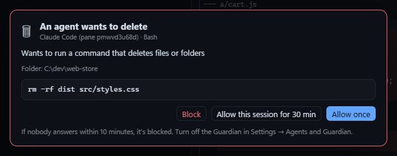
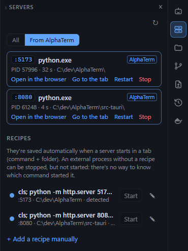

<p align="center">
  
</p>

<h1 align="center">AlphaTerm</h1>

<p align="center">
  A terminal for Windows and Linux built for working with several AI agents at once.<br>
  Tauri 2 · SolidJS · xterm.js 6 — version 0.8.0
</p>

<p align="center"><b>English</b> · <a href="README.es.md">Español</a> · <a href="README.pt.md">Português</a></p>

<p align="center"><b>The app speaks three languages: English, Spanish and Portuguese.</b><br>
Switch it live in Settings → Language; a new install starts in your system's language.<br>
<sub>The screenshots below show the English interface.</sub></p>


## Features

- **Three languages**: English, Spanish and Portuguese, switched live from Settings → Language. A new install follows the system language.
- **Tabs and tiled panes**: split, drag panes around by their bar, and dividers that snap at ⅓, ½ and ⅔. The session is restored on startup.
- **Command suggestions** in PowerShell and cmd, and on Linux in bash, zsh and fish: folders for `cd`, history, branches, scripts and a catalog of commands with descriptions.
- **Agents**: launch Claude Code, Codex, Antigravity or OpenCode, picking model, effort and permissions. Usage (5-hour window and week) is shown live in the footer.
- **Changes**: a diff of what each agent changed, including files outside git, with editing right in the panel.
- **Guardian**: asks before an agent deletes or modifies files.
- **Built-in browser**: mark elements on the page and ask the tab's agent to change them.
- **Side panels**: servers and ports (with recipes to start them again), Git, Docker, command history and projects.
- **Control API**: local HTTP (with a token) plus an MCP server, so an agent can open tabs, run commands and read their output.
- 11 built-in themes (imports from Windows Terminal and iTerm2), transparent background, configurable shortcuts, and pasting images as a file path.

| Agent changes | Browser with element marking |
| :---: | :---: |
|  |  |
| **Guardian** | **Servers** |
|  |  |

<p align="center">
  
</p>

## Libraries

| Part | Uses |
| --- | --- |
| Window and backend | [Tauri 2](https://tauri.app) (Rust) on WebView2, with the clipboard-manager, dialog and opener plugins |
| UI | [SolidJS](https://www.solidjs.com) 1.9, TypeScript and Vite 8 |
| Terminal | [xterm.js](https://xtermjs.org) 6 with WebGL (fit, search, web-links, unicode11 and ligatures addons) |
| Shells | portable-pty on ConPTY (ships Microsoft's `OpenConsole.exe` and `conpty.dll`) |
| Rest of the backend | sysinfo (CPU and RAM), notify and ignore (folder watching), similar (diffs), tiny_http (control API), reqwest, vt100, ruzstd, pdf-extract, winreg and webview2-com |
| Tests | Vitest and `cargo test` |

## Installation

Runs on Windows 10 and 11 and on Linux (tested on Ubuntu 26.04 with GNOME, on Wayland and X11).

### Windows

Requirements:

- Node 22
- Stable Rust (MSVC toolchain) and Visual Studio Build Tools with "Desktop development with C++" (see the [Tauri prerequisites](https://tauri.app/start/prerequisites/))
- WebView2 (included with Windows 11)
- Optional: the agents you want to use (`claude`, `codex`, `agy`, `opencode`), Git and Docker

```powershell
git clone https://github.com/missingus3r/AlphaTerm.git
cd AlphaTerm
npm install
npx tauri dev                  # development, with hot reload
npx tauri build --no-bundle    # builds src-tauri\target\release\alphaterm.exe
```

To cut a release, double-click `build-release.bat`. It bumps the version, commits and tags it, builds, and installs to `%LOCALAPPDATA%\AlphaTerm\versiones\<version>` with a desktop shortcut. It stops first if a commit message has no English or Portuguese translation for "What's new" (`node scripts/changelog.mjs --faltan` lists them).

Settings and data live in `%APPDATA%\AlphaTerm`.

### Linux

Requirements: Node 22, stable Rust ([rustup](https://rustup.rs)) and the WebKitGTK libraries. On Ubuntu or Debian:

```bash
sudo apt install git build-essential pkg-config libssl-dev libwebkit2gtk-4.1-dev \
  libayatana-appindicator3-dev librsvg2-dev libxdo-dev nodejs npm
```

```bash
git clone https://github.com/missingus3r/AlphaTerm.git
cd AlphaTerm
npm install
npx tauri dev                  # development, with hot reload
npx tauri build --no-bundle    # builds src-tauri/target/release/alphaterm
```

To cut a release: `./build-release.sh` (same options as the `.bat`). It installs to `~/.local/share/AlphaTerm/versiones/<version>` and puts AlphaTerm in the applications menu; if you pin it to the dock, the pin follows the new version. `npx tauri build` without `--no-bundle` also builds a `.deb` and an AppImage.

Settings and data live in `~/.config/AlphaTerm`.

What changes on Linux:

- The shells are bash, zsh and fish (with integration: folder, exit code and history); the default one is yours (`$SHELL`).
- The built-in browser is WebKitGTK. The clicks and keys that agents send (`browser_click`, `browser_key`…) are DOM events, not system ones: sites that only accept "trusted" events (some rich text editors, for example) may not react.
- There are no Mica or Acrylic effects; background opacity depends on the desktop allowing transparent windows.
- The Guardian and everything else work the same.

Tests: `npx vitest run`, `npx tsc --noEmit`, and `cargo test` inside `src-tauri`. `node scripts/i18n-check.mjs` checks that every interface text has its translations.

## Translations

The source text is Spanish: each interface text goes through `t("…")` and its translations live in `src/i18n/en/*.json` and `src/i18n/pt/*.json` (Spanish text as the key). The Rust backend picks among three versions of each message (`src-tauri/src/i18n.rs`). Terms and style: [`src/i18n/GLOSSARY.md`](src/i18n/GLOSSARY.md).

## More documentation

- [`CLAUDE.en.md`](CLAUDE.en.md): status, how to test, and known gotchas.
- [`docs/en/Code_Guide.txt`](docs/en/Code_Guide.txt): how the code is organized.
- [`docs/en/Process_Report.md`](docs/en/Process_Report.md): log of each phase.
- [`docs/en/Terminal_Plan.txt`](docs/en/Terminal_Plan.txt) and [`docs/en/specs/`](docs/en/specs): the original plan and the feature designs.

## License

[MIT](LICENSE). The bundled ConPTY files are Microsoft's, also MIT: see [`THIRD-PARTY-NOTICES.md`](THIRD-PARTY-NOTICES.md).
