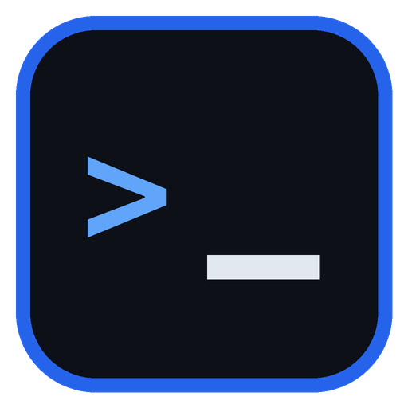
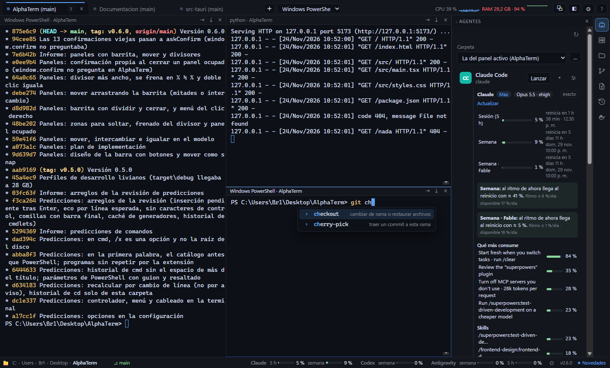
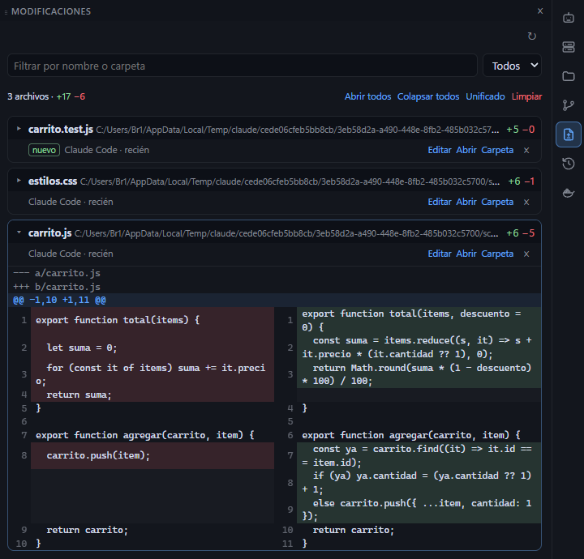
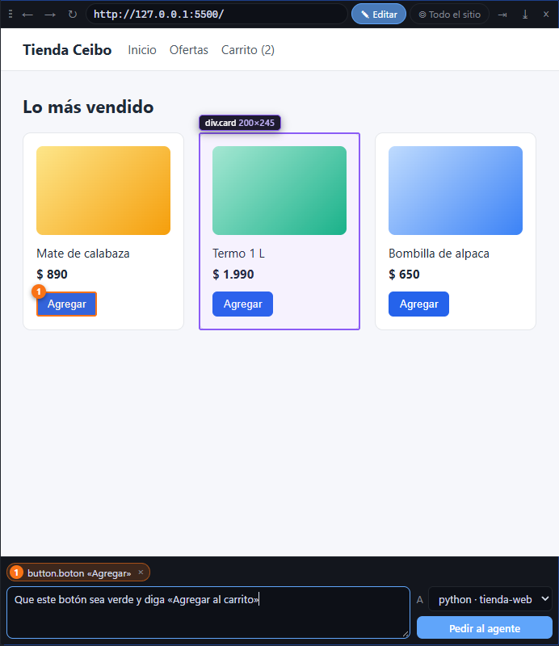
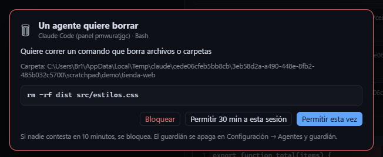
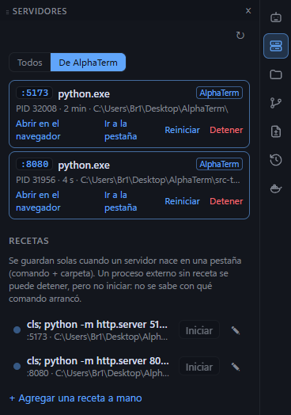
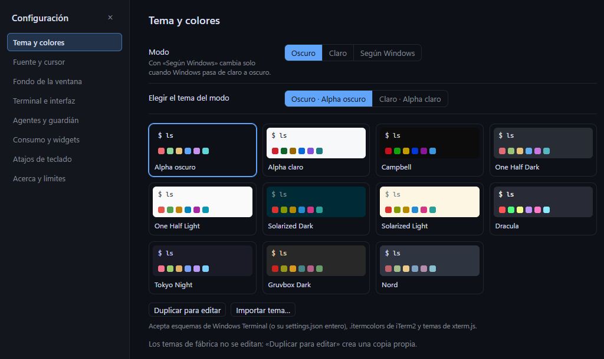

<p align="center">
  
</p>

<h1 align="center">AlphaTerm</h1>

<p align="center">
  A Windows terminal built for working with several AI agents at once.<br>
  Tauri 2 · SolidJS · xterm.js 6 — version 0.6.0
</p>



> The interface is in Spanish.

## Features

- **Tabs and tiled panes**: split, drag panes around by their title bar, and dividers that snap at ⅓, ½ and ⅔. The session is restored on startup.
- **Command suggestions** in PowerShell and cmd: folders for `cd`, history, branches, scripts and a catalog of commands with descriptions.
- **Agents**: launch Claude Code, Codex, Antigravity or OpenCode, picking model, effort and permissions. Usage (5-hour and weekly) is shown live in the footer.
- **Changes**: a diff of what each agent changed, including files outside git, with editing right in the panel.
- **Guardian**: asks before an agent deletes or modifies files.
- **Built-in browser**: mark elements on the page and ask the tab's agent to change them.
- **Side panels**: servers and ports (with recipes to start them again), Git, Docker, command history and projects.
- **Control API**: local HTTP (with a token) plus an MCP server, so an agent can open tabs, run commands and read their output.
- 11 built-in themes (imports from Windows Terminal and iTerm2), transparent background, configurable shortcuts, and pasting images as a file path.

| Agent changes | Browser with element marking |
| :---: | :---: |
|  |  |
| **Guardian** | **Servers** |
|  |  |

<p align="center">
  
</p>

## Libraries

| Part | Uses |
| --- | --- |
| Window and backend | [Tauri 2](https://tauri.app) (Rust) on WebView2, with the clipboard-manager, dialog and opener plugins |
| UI | [SolidJS](https://www.solidjs.com) 1.9, TypeScript and Vite 8 |
| Terminal | [xterm.js](https://xtermjs.org) 6 with WebGL (fit, search, web-links, unicode11 and ligatures addons) |
| Shells | portable-pty on ConPTY (ships Microsoft's `OpenConsole.exe` and `conpty.dll`) |
| Rest of the backend | sysinfo (CPU and RAM), notify and ignore (folder watching), similar (diffs), tiny_http (control API), reqwest, vt100, ruzstd, pdf-extract, winreg and webview2-com |
| Tests | Vitest and `cargo test` |

## Installation

Windows 10 and 11 only, for now.

Requirements:

- Node 22
- Stable Rust (MSVC toolchain) and Visual Studio Build Tools with "Desktop development with C++" (see the [Tauri prerequisites](https://tauri.app/start/prerequisites/))
- WebView2 (included with Windows 11)
- Optional: the agents you want to use (`claude`, `codex`, `agy`, `opencode`), Git and Docker

```powershell
git clone https://github.com/missingus3r/AlphaTerm.git
cd AlphaTerm
npm install
npx tauri dev                  # development, with hot reload
npx tauri build --no-bundle    # builds src-tauri\target\release\alphaterm.exe
```

To cut a release, double-click `compilar-version.bat`. It bumps the version, commits and tags it, builds, and installs to `%LOCALAPPDATA%\AlphaTerm\versiones\<version>` with a desktop shortcut.

Settings and data live in `%APPDATA%\AlphaTerm`.

Tests: `npx vitest run`, `npx tsc --noEmit`, and `cargo test` inside `src-tauri`.

## More documentation (in Spanish)

- [`CLAUDE.md`](CLAUDE.md): status, how to test, and known gotchas.
- [`Documentacion/Guia_de_codigo.txt`](Documentacion/Guia_de_codigo.txt): how the code is organized.
- [`Documentacion/Informe_Proceso_y_Stats.md`](Documentacion/Informe_Proceso_y_Stats.md): log of each phase.
