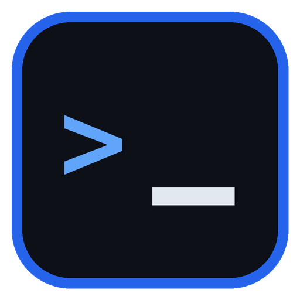
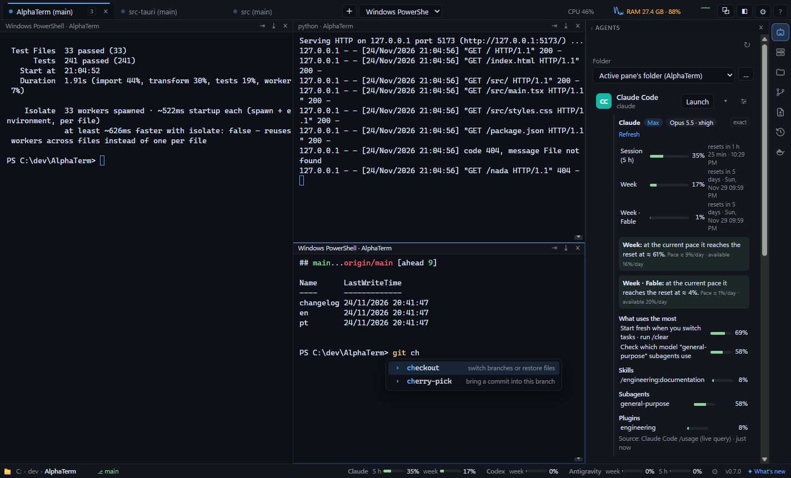
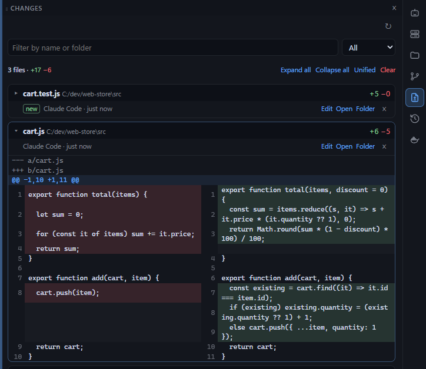
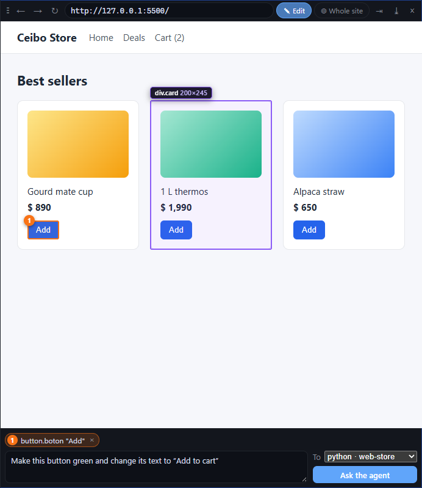
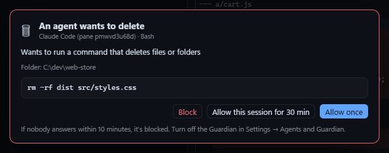
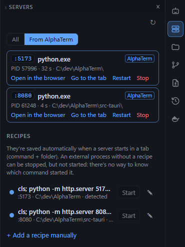
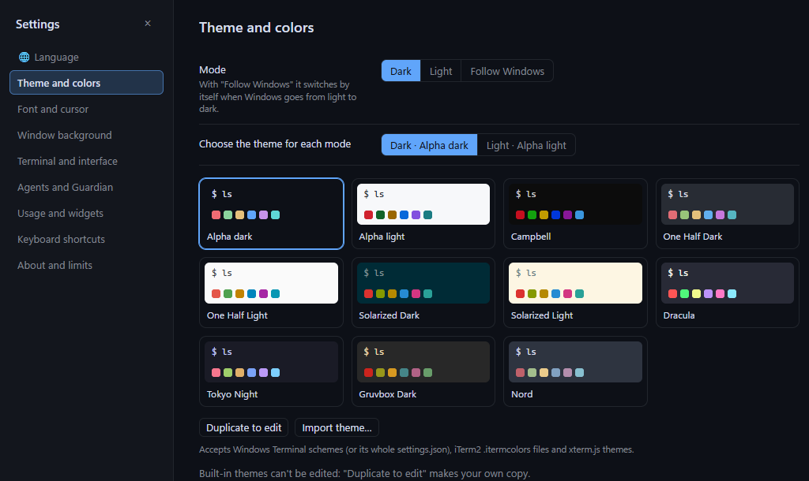

<p align="center">
  
</p>

<h1 align="center">AlphaTerm</h1>

<p align="center">
  Terminal para Windows e Linux feito para trabalhar com vários agentes de IA ao mesmo tempo.<br>
  Tauri 2 · SolidJS · xterm.js 6 — versão 0.8.0
</p>

<p align="center"><a href="README.md">English</a> · <a href="README.es.md">Español</a> · <b>Português</b></p>

<p align="center"><b>O app fala três idiomas: português, inglês e espanhol.</b><br>
Troque na hora em Configurações → Idioma; uma instalação nova começa no idioma do sistema.<br>
<sub>As capturas abaixo mostram a interface em inglês.</sub></p>



## Recursos

- **Três idiomas**: português, inglês e espanhol, trocados na hora em Configurações → Idioma. Uma instalação nova segue o idioma do sistema.
- **Abas e painéis lado a lado**: dividir, mover painéis arrastando a barra deles e divisores que param em ⅓, ½ e ⅔. A sessão é restaurada ao abrir.
- **Sugestões de comandos** no PowerShell e no cmd, e no Linux no bash, zsh e fish: pastas para `cd`, histórico, branches, scripts e um catálogo de comandos com explicação.
- **Agentes**: inicie Claude Code, Codex, Antigravity ou OpenCode escolhendo modelo, esforço e permissões. O uso (janela de 5 h e semana) aparece ao vivo no rodapé.
- **Alterações**: o diff do que cada agente mudou, inclusive em arquivos fora do git, com edição no próprio painel.
- **Guardião**: pergunta antes de um agente apagar ou modificar arquivos.
- **Navegador integrado**: marque elementos da página e peça a mudança ao agente da aba.
- **Painéis laterais**: servidores e portas (com receitas para iniciá-los de novo), Git, Docker, histórico de comandos e projetos.
- **API de controle** local (HTTP com token e servidor MCP) para um agente abrir abas, rodar comandos e ler a saída.
- 11 temas prontos (importa do Windows Terminal e do iTerm2), fundo transparente, atalhos configuráveis e colar imagens como caminho de arquivo.

| Alterações dos agentes | Navegador com marcação |
| :---: | :---: |
|  |  |
| **Guardião** | **Servidores** |
|  |  |

<p align="center">
  
</p>

## Bibliotecas

| Parte | Usa |
| --- | --- |
| Janela e backend | [Tauri 2](https://tauri.app) (Rust) sobre WebView2, com os plugins clipboard-manager, dialog e opener |
| Interface | [SolidJS](https://www.solidjs.com) 1.9, TypeScript e Vite 8 |
| Terminal | [xterm.js](https://xtermjs.org) 6 com WebGL (addons fit, search, web-links, unicode11 e ligatures) |
| Shells | portable-pty sobre ConPTY (inclui `OpenConsole.exe` e `conpty.dll` da Microsoft) |
| Resto do backend | sysinfo (CPU e RAM), notify e ignore (vigiar pastas), similar (diffs), tiny_http (API de controle), reqwest, vt100, ruzstd, pdf-extract, winreg e webview2-com |
| Testes | Vitest e `cargo test` |

## Instalação

Funciona no Windows 10 e 11 e no Linux (testado no Ubuntu 26.04 com GNOME, em Wayland e X11).

### Windows

Requisitos:

- Node 22
- Rust estável (toolchain MSVC) e Visual Studio Build Tools com "Desenvolvimento para desktop com C++" (veja os [pré-requisitos do Tauri](https://tauri.app/start/prerequisites/))
- WebView2 (já vem no Windows 11)
- Opcional: os agentes que você quiser usar (`claude`, `codex`, `agy`, `opencode`), Git e Docker

```powershell
git clone https://github.com/missingus3r/AlphaTerm.git
cd AlphaTerm
npm install
npx tauri dev                  # desenvolvimento, com recarga automática
npx tauri build --no-bundle    # gera src-tauri\target\release\alphaterm.exe
```

Para gerar uma versão, clique duas vezes em `build-release.bat`. Ele sobe o número da versão, faz o commit e a tag, compila e instala em `%LOCALAPPDATA%\AlphaTerm\versiones\<versão>` com atalho na área de trabalho. Antes disso, para se algum commit não tiver tradução para inglês e português em "Novidades" (`node scripts/changelog.mjs --faltan` lista quais).

As configurações e os dados ficam em `%APPDATA%\AlphaTerm`.

### Linux

Requisitos: Node 22, Rust estável ([rustup](https://rustup.rs)) e as bibliotecas do WebKitGTK. No Ubuntu ou Debian:

```bash
sudo apt install git build-essential pkg-config libssl-dev libwebkit2gtk-4.1-dev \
  libayatana-appindicator3-dev librsvg2-dev libxdo-dev nodejs npm
```

```bash
git clone https://github.com/missingus3r/AlphaTerm.git
cd AlphaTerm
npm install
npx tauri dev                  # desenvolvimento, com recarga automática
npx tauri build --no-bundle    # gera src-tauri/target/release/alphaterm
```

Para gerar uma versão: `./build-release.sh` (as mesmas opções do `.bat`). Instala em `~/.local/share/AlphaTerm/versiones/<versão>` e coloca o AlphaTerm no menu de aplicativos; se você fixá-lo na dock, o atalho acompanha a versão nova. `npx tauri build` sem `--no-bundle` também gera um `.deb` e um AppImage.

As configurações e os dados ficam em `~/.config/AlphaTerm`.

O que muda no Linux:

- Os shells são bash, zsh e fish (com integração: pasta, código de saída e histórico); o padrão é o seu (`$SHELL`).
- O navegador integrado é o WebKitGTK. Os cliques e teclas que os agentes enviam (`browser_click`, `browser_key`…) são eventos do DOM, não do sistema: sites que só aceitam eventos "confiáveis" (alguns editores de texto rico, por exemplo) podem não reagir.
- Não há efeitos Mica nem Acrylic; a opacidade do fundo depende de a área de trabalho permitir janelas transparentes.
- O Guardião e todo o resto funcionam igual.

Testes: `npx vitest run`, `npx tsc --noEmit` e `cargo test` dentro de `src-tauri`. `node scripts/i18n-check.mjs` confere se cada texto da interface tem suas traduções.

## Traduções

O texto de origem é o espanhol: cada texto da interface passa por `t("…")` e as traduções ficam em `src/i18n/en/*.json` e `src/i18n/pt/*.json` (com o texto em espanhol como chave). O backend em Rust escolhe entre as três versões de cada mensagem (`src-tauri/src/i18n.rs`). Termos e estilo: [`src/i18n/GLOSSARY.md`](src/i18n/GLOSSARY.md).

## Mais documentação

- [`CLAUDE.pt.md`](CLAUDE.pt.md): estado, como testar e armadilhas conhecidas.
- [`docs/pt/Code_Guide.txt`](docs/pt/Code_Guide.txt): como o código está organizado.
- [`docs/pt/Process_Report.md`](docs/pt/Process_Report.md): registro de cada fase.
- [`docs/pt/Terminal_Plan.txt`](docs/pt/Terminal_Plan.txt) e [`docs/pt/specs/`](docs/pt/specs): o plano original e os designs de cada recurso.

## Licença

[MIT](LICENSE). Os arquivos do ConPTY incluídos são da Microsoft, também MIT: veja [`THIRD-PARTY-NOTICES.md`](THIRD-PARTY-NOTICES.md).
